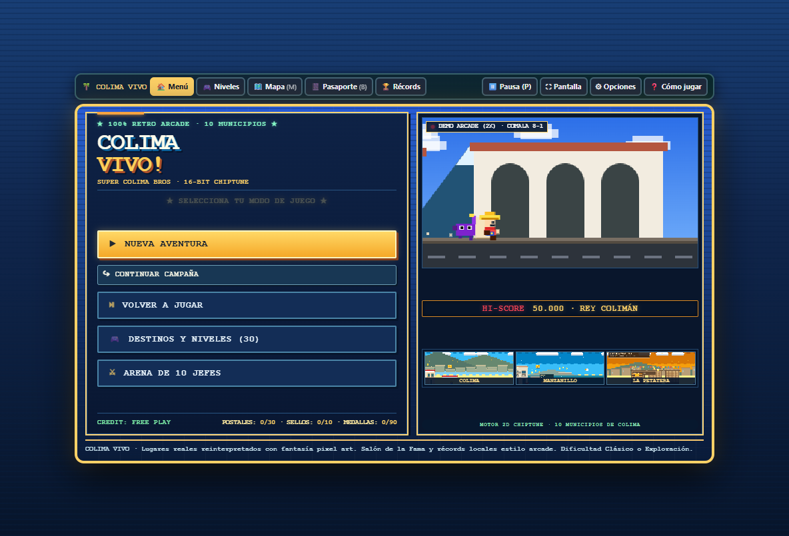
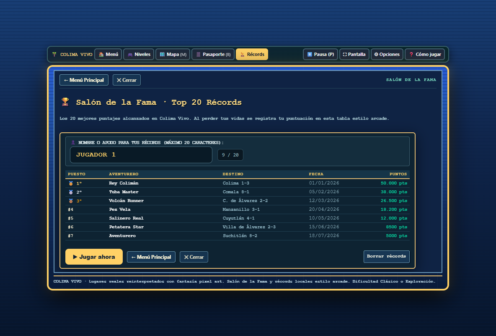
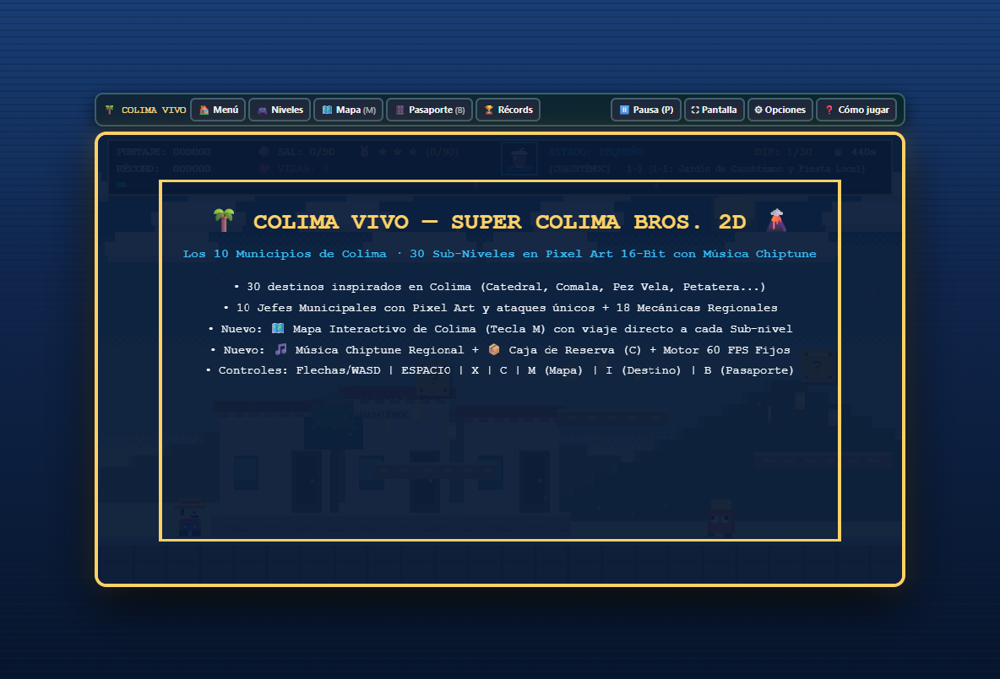
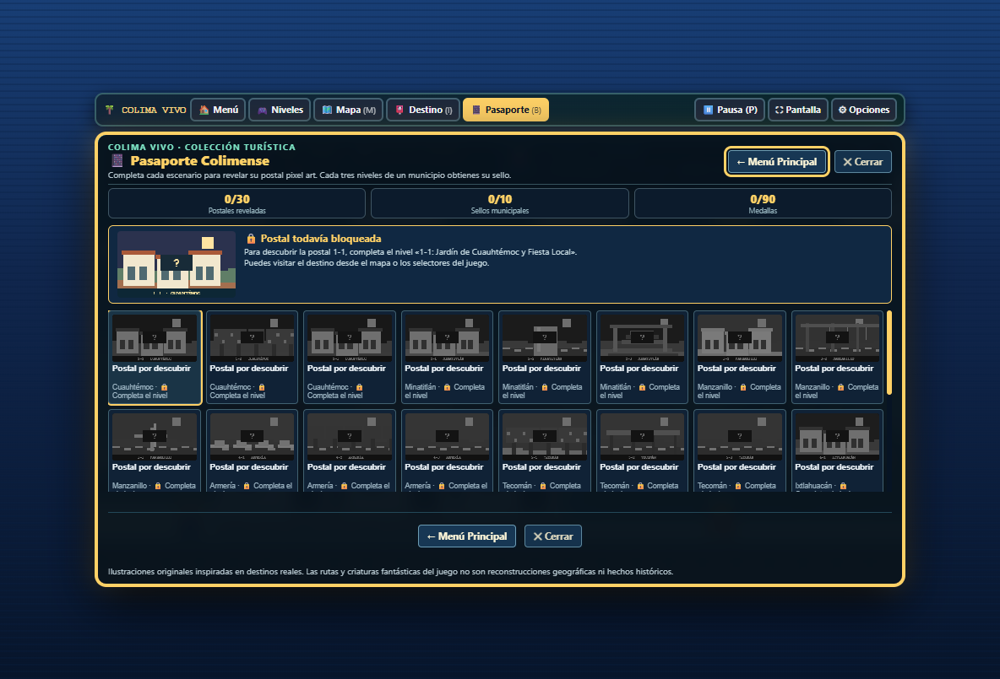

# 🌴 Colima Vivo! (Super Colima Bros 2D) 🌋

[](#)
[](#)
[](#)
[-blue)](#)
[](LICENSE)

> **Homenaje retro arcade de plataformas en 16-bit chiptune a los 10 municipios del Estado de Colima, México.**  
> Explora 30 escenarios turísticos emblemáticos, derrota a 10 jefes municipales únicos, colecciona postales en tu Pasaporte Colimense y alcanza la cima del Salón de la Fama.

---

## 📸 Galería y Capturas de Pantalla

| Menú de Inicio Arcade (Menos es Más) | Salón de la Fama (Top 20 Récords) |
| :---: | :---: |
|  |  |

| Aventura en los 10 Municipios | Pasaporte Colimense y Sellos |
| :---: | :---: |
|  |  |

---

## 🌟 Características Principales

- 🗺️ **10 Municipios & 30 Destinos Turísticos**:
  - Recreación en auténtico pixel art de lugares representativos: Catedral de Colima, Portales de Comala, La Petatera de Villa de Álvarez, Pez Vela de Manzanillo, Salineras de Cuyutlán, Volcán de Fuego, Peñitas de Minatitlán y más.
- ⚔️ **10 Jefes Municipales con Arenas Únicas**:
  - Enfrentamientos épicos con patrones diferenciados: *Rey Colimán*, *Pez Vela Gigante*, *Guardián del Volcán*, *El Chango Minero*, entre otros.
- 📔 **Pasaporte Colimense Coleccionable**:
  - Desbloquea 30 postales ilustradas y 10 sellos oficiales al completar los destinos de cada municipio.
- 🏆 **Salón de la Fama Arcade (Top 20)**:
  - Registro automático de puntuación alta con apodo personalizado y persistencia local (`localStorage`).
- 🍋 **Poderes y Mecánicas Regionales**:
  - Ataque arrojadizo de limones, tuba curativa refrescante, sal marina de Cuyutlán y física ágil de plataformas en 60 FPS.
- 📺 **Modo Monitor CRT Retro & Audio Chiptune**:
  - Emulación de líneas de escaneo (scanlines) estilo recreativa clásica y banda sonora procedural con Web Audio API (cero archivos pesados).
- 📱 **100% Adaptable y Soporte Móvil**:
  - Controles táctiles integrados transparentes para teléfonos y tabletas.

---

## 🕹️ Controles de Juego

### ⌨️ Teclado (PC / Laptop)

| Acción | Teclas Primarias | Teclas Secundarias |
| :--- | :---: | :---: |
| **Moverse** | <kbd>←</kbd> <kbd>→</kbd> | <kbd>A</kbd> <kbd>D</kbd> |
| **Agacharse** | <kbd>↓</kbd> | <kbd>S</kbd> |
| **Saltar** | <kbd>Espacio</kbd> | <kbd>W</kbd> / <kbd>↑</kbd> |
| **Lanzar Limón / Atacar** | <kbd>X</kbd> | <kbd>J</kbd> |
| **Caja de Reserva** | <kbd>C</kbd> | — |
| **Pausa / Menú** | <kbd>P</kbd> | <kbd>Esc</kbd> |
| **Mapa Interactivo** | <kbd>M</kbd> | — |
| **Pasaporte Colimense** | <kbd>B</kbd> | — |
| **Información del Destino** | <kbd>I</kbd> | — |

### 📱 Pantalla Táctil (Móviles / Tablets)
- Cruzeta virtual izquierda para desplazarse.
- Botones de acción directos: 🍋 (Lanzar limón) y ▲ (Saltar).
- Barra superior de herramientas siempre accesible para cambiar opciones y sonido.

---

## 🚀 Cómo Jugar y Ejecutar

### Opción 1: Directamente en el Navegador (Sin instalación)
Simplemente abre el archivo `index.html` en cualquier navegador web moderno (Chrome, Edge, Firefox, Safari).

### Opción 2: Con Servidor Local Node.js
```bash
# Clonar el repositorio
git clone https://github.com/vcamachoone/colimavive.git
cd colimavive

# Iniciar servidor local
npm start
```
Abre en tu navegador: **[http://localhost:8085](http://localhost:8085)**.

### Opción 3: Publicación en GitHub Pages
1. Ve a **Settings > Pages** en el repositorio de GitHub.
2. En **Build and deployment > Source**, selecciona **Deploy from a branch**.
3. Selecciona la rama `main` y la carpeta `/ (root)`.
4. El juego estará disponible en línea en: `https://vcamachoone.github.io/colimavive/`.

---

## 📁 Estructura del Repositorio

```text
colimavive/
├── index.html                   # Entrada principal del videojuego (optimizada para web y GitHub Pages)
├── Colima_Vivo_1_0_Senaletica_Postales_Corregidas.html  # Archivo maestro del motor de juego
├── server.js                    # Servidor estático Node.js con soporte MIME y CORS
├── package.json                 # Metadatos del proyecto y scripts npm
├── LICENSE                      # Licencia MIT de código abierto
├── README.md                    # Documentación profesional del proyecto
├── .gitignore                   # Exclusión de temporales, logs y dependencias
├── assets/                      # Recursos multimedia y gráficos promocionales
│   ├── Colima_Vivo_Senaletica_Comparativa.png
│   └── screenshots/             # Capturas de pantalla de alta fidelidad
│       ├── menu_arcade_home.png
│       ├── highscores_top20.png
│       ├── gameplay_action.png
│       └── passport_screen.png
└── docs/                        # Informes técnicos, auditorías de accesibilidad y validaciones
    ├── Auditoria_Colima_Vivo_1_0.md
    ├── Colima_Vivo_Senaletica_Validacion_30_Niveles.csv
    ├── Reporte_Colima_Vivo_Senaletica_Postales.md
    ├── PROJECT.md
    ├── TEST_INFRA.md
    ├── TEST_READY.md
    └── DEAD_ENDS.md
```

---

## 🏛️ Municipios Representados

1. **Cuauhtémoc** · Fiestas locales, Quesería y horizonte volcánico.
2. **Villa de Álvarez** · Plaza de Toros La Petatera y Fiestas Charrotaurinas.
3. **Manzanillo** · Playas de la bahía, Pez Vela y Malecón.
4. **Armería** · Playas de Cuyutlán, ola verde y Museo de la Sal.
5. **Tecomán** · Capital limonera, playas y escultura El Limonero.
6. **Coquimatlán** · Ríos, huertas y balnearios tradicionales.
7. **Ixtlahuacán** · Grutas de San Gabriel y senderismo natural.
8. **Comala** · Pueblo Mágico, portales blancos y vista al volcán.
9. **Minatitlán** · Cascadas de El Salto y zona minera Peña Colorada.
10. **Colima Capital** · Jardín Libertad, Palacio de Gobierno y Catedral Basílica Menor.

---

## 📄 Licencia

Este proyecto se distribuye bajo la licencia **MIT**. Consulta el archivo [LICENSE](LICENSE) para más información.
Desarrollado con orgullo y pasión por la cultura colimense.
